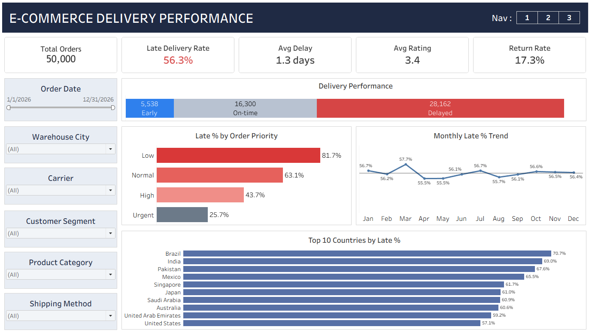
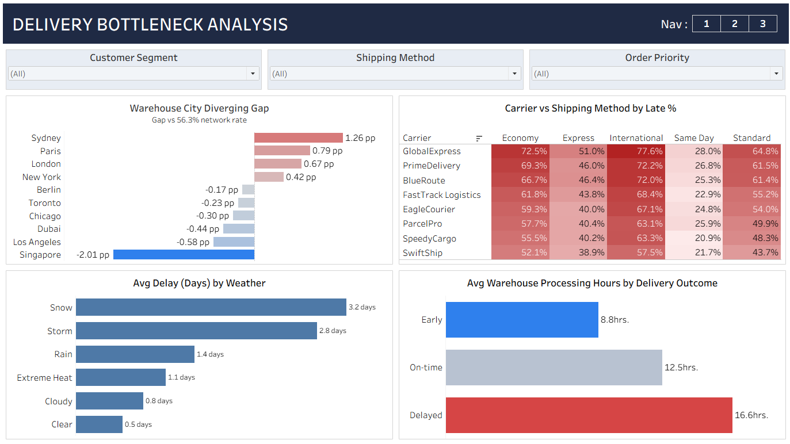
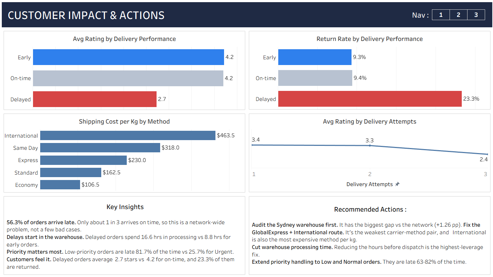

# 📦 E-Commerce Delivery Performance: Why 56% of Orders Arrive Late

**End-to-end analysis of 50,000 e-commerce orders (2026) using Python (pandas, seaborn), SQL Server and Tableau, to find why more than half of all orders arrive late, where the delay starts, and what it costs in ratings and returns.**

📊 [View Live Tableau Dashboard](https://public.tableau.com/app/profile/sahil.bhowad/viz/E-CommerceShippingDeliveryPerformanceAnalysis/ExecutiveOverview?publish=yes) | 📓 [View Notebook](https://github.com/SahilBhowad/ecommerce-delivery-bottleneck-analysis/blob/main/notebook/e-commerce_delivery_analysis.ipynb) | 🗄️ [View SQL Queries](https://github.com/SahilBhowad/ecommerce-delivery-bottleneck-analysis/blob/main/sql/e-commerce_delivery_analysis.sql) | 📥 [Download Tableau File](https://github.com/SahilBhowad/ecommerce-delivery-bottleneck-analysis/blob/main/tableau/E-Commerce%20Shipping%20%26%20Delivery%20Performance%20Analysis.twbx) | 📦 50,000 Orders Analyzed

---

## 📌 The Business Problem

Imagine you run operations for an e-commerce company. Customers are complaining about late parcels, returns are going up and ratings are going down. The question:

> **Which warehouse, carrier and shipping method combinations cause the delays, and what is really driving them?**

**Data:** 1 Jan 2026 to 31 Dec 2026. 50,000 orders and 30 columns, including order dates, promised vs actual delivery days, warehouses, carriers, shipping methods, order priority, weather, delivery attempts, customer ratings and return reasons. I added 5 columns in Python: `order_day`, `order_month`, `shipping_cost_per_kg`, `delivery_variance_days` and `delivery_performance` (Early / On-time / Delayed).

---



---

## 💡 The Story in One Minute

* **How big is the problem?** **56.3%** of orders arrive late. Only 1 in 3 arrives on time, and the rate stays between 55.5% and 57.7% every month. It is built into the process, not a seasonal blip.
* **Where does it start?** Inside the warehouse. Delayed orders spend **16.6 hours** in processing vs **8.8 hours** for early orders.
* **Which route is the worst?** **GlobalExpress + International** is **77.6%** late. International is the weakest method for every carrier, and it is also the most expensive.
* **Who gets served first?** Urgent orders are late **25.7%** of the time. Low-priority orders are late **81.7%** of the time.
* **Who pays?** The customer. Ratings fall from **4.2 to 2.7 stars**, and returns jump from about **9%** to **23.3%**.

These are patterns in one year of orders, not proof of why they happen.

---

## 🛠️ Tools & Approach

| Stage | What I did |
|---|---|
| Cleaning | Checked types and nulls, fixed the date column, removed duplicates, labelled empty return reasons as "Not returned" |
| Integrity check | Compared the dataset's delay column with my own calculation and explained all 5,536 differences |
| Features | Built a signed delay column and the Early / On-time / Delayed label |
| Analysis | Groupby analysis and charts in Python by warehouse, carrier, method, priority, processing time, ratings, returns and cost |
| SQL layer | 24 queries in SQL Server (aggregates, CASE WHEN, window functions, CTEs). The last 9 re-check every dashboard number |
| Dashboard | 3-page Tableau report with filters, a heatmap and a benchmark against the network average |

<details>
<summary><b>📋 Full workflow: what I did, step by step (click to expand)</b></summary>

1. **Looked at the raw file:** shape, column types and missing values.
2. **Converted `order_date`** from text to a real date, after checking the actual format.
3. **Handled the empty `return_reason` values.** They are empty because the order was never returned, so I labelled them "Not returned" and kept every row.
4. **Checked the delay column.** The dataset's `delivery_delay_days` did not match `actual - promised` in 5,536 rows. All of them were early deliveries, because the dataset sets early deliveries to 0. After applying the same rule to my calculation, the differences dropped to 0.
5. **Kept two delay columns.** `delivery_delay_days` shows lateness only. `delivery_variance_days` keeps early deliveries as negative numbers, so I could label each order Early, On-time or Delayed.
6. **Explored the data** by warehouse, carrier, method, priority, processing time, ratings, returns and cost.
7. **Repeated the numbers in SQL**, then **built the Tableau dashboard**.
8. **Checked the dashboard against SQL** (Q16-Q24) so Python, SQL and Tableau all show the same numbers.

</details>

<details>
<summary><b>📖 The metrics in simple words (click to expand)</b></summary>

* **Late %:** orders delivered after the promised day, divided by all orders.
* **Percentage points (pp):** the gap between two percentages. If a warehouse is at 57.6% and the network is at 56.3%, the gap is **+1.3 pp**, not "1.3%".
* **Network average:** the late rate of all 50,000 orders. In Tableau it uses a `FIXED` calculation, so filters do not change it.
* **Variance:** how much delivery times swing around. A high-variance warehouse is unpredictable, not just slow.
* **Cost per kg:** each order's shipping cost divided by its weight, then averaged. Very light parcels push this number up, so use it to compare methods, not as an exact price.

</details>

---

## 🔎 Findings

| # | Finding | Evidence | Recommendation |
|---|---|---|---|
| 1 | Late delivery is the normal outcome | 56.3% late, 32.6% on-time, 11.1% early. Flat all year | Treat it as a process problem, not a seasonal one |
| 2 | The delay starts in the warehouse | Processing time: Early 8.8 h, On-time 12.5 h, Delayed 16.6 h | Cut processing time before dispatch |
| 3 | One route is the weakest | GlobalExpress + International is 77.6% late. International is 57.5%-77.6% late for every carrier. Same Day is 20.9%-28.0% | Renegotiate the SLA or move International volume |
| 4 | Priority only protects the top tier | Late: Low 81.7%, Normal 63.1%, High 43.7%, Urgent 25.7% | Extend priority handling to Normal and Low orders |
| 5 | Sydney is the worst warehouse, but the gap is small | Sydney 1.32 days of delay and +1.26 pp. Singapore is best at -2.01 pp. All warehouses are within about ±2 pp | Audit Sydney first, but fix the network, not one site |
| 6 | Weather adds delay but does not explain it | Snow 3.2 days, Storm 2.8, Rain 1.4, Clear 0.5 | Pad promised dates in snow and storms |
| 7 | Late delivery hurts customers | Rating 4.2 (early and on-time) vs 2.7 (delayed). Returns 9.3% and 9.4% vs 23.3%. Ratings by attempts: 3.4, 3.3, 2.4 | Protect on-time delivery and avoid third delivery attempts |
| 8 | The costliest method is the least reliable | International $463.5 per kg vs Economy $106.5 | Review International pricing against its service level |

*Berlin, New York, Paris and Sydney also have the highest delivery variance (1.85), so they are unpredictable as well as slow. These need better scheduling, not only faster work.*

---

## 🗄️ SQL Highlight

I loaded the cleaned data into SQL Server as `ecommerce_shipping` and wrote 24 queries, grouped by skill: aggregates, CASE WHEN, window functions, CTEs, a stakeholder summary and a dashboard check. Each query has a short insight line. Q16-Q24 re-compute the dashboard numbers (KPIs, priority, countries, warehouse gap in pp, processing hours, ratings, returns, attempts, weather, cost per kg), so the Tableau report is checked against the database.

```sql
-- Each carrier's own worst shipping method (partitioned ranking)
SELECT 
    carrier, shipping_method,
    ROUND(SUM(CASE WHEN late_delivery = 'Yes' THEN 1 ELSE 0 END) * 100 / CAST(COUNT(*) AS FLOAT), 2) AS delay_pct,
    RANK() OVER (
        PARTITION BY carrier 
        ORDER BY SUM(CASE WHEN late_delivery = 'Yes' THEN 1 ELSE 0 END) * 100 / CAST(COUNT(*) AS FLOAT) DESC
    ) AS rank_within_carrier
FROM ecommerce_shipping
GROUP BY carrier, shipping_method;
```
*A single global ranking would hide each carrier's own weak point.*

Full file: `sql/e-commerce_delivery_analysis.sql`

---

## 📊 Dashboard Features

| Page | Question it answers | What you see |
|---|---|---|
| 1. Executive Overview | How bad is it? | 5 KPI cards, Early / On-time / Delayed split, late % by priority, monthly trend, top 10 countries |
| 2. Bottleneck Analysis | Where is it happening? | Warehouse gap vs network (pp), carrier × method heatmap, delay by weather, processing hours by outcome |
| 3. Customer Impact & Actions | What does it cost, and what do we fix? | Ratings, returns, cost per kg, rating by attempts, key insights and recommended actions |




* **Filters:** order date, warehouse, carrier, customer segment, product category, shipping method and order priority
* **Navigation:** buttons 1 | 2 | 3 in every header
* **Colour code:** red means late or worse than the network, blue means early or better, grey is neutral

Tip: pick a carrier or shipping method in the filters and watch the late rate change on every chart.

---

## ⚠️ Limitations & Next Steps

**Limitations**

* The data shows **patterns, not causes**. It records weather, but not other reasons for delay such as traffic, staffing or carrier capacity.
* It covers **one year (2026)**, so I cannot say if the problem is getting better or worse over time.
* Warehouse differences are small (about ±2 pp), so warehouse rankings should be read with care.
* Cost per kg is an average of each order's cost ÷ weight, which light parcels inflate. The ranking of methods stays the same with total cost ÷ total weight.
* Ratings and return reasons are self-reported and can reflect more than delivery speed.
* Some orders marked "In Transit" already carry an actual delivery value. All delay numbers include every order.

**Next Steps**

* Build a model that flags orders likely to be late when they are placed.
* Add cost data per warehouse and carrier to weigh each fix against its savings.
* Track the same metrics every month to see the trend.

---

## 🎓 What I Learned

* Not to trust a pre-built column without checking it. My own calculation found 5,536 differences, all with a clear reason.
* Why a signed delay column (keeps early deliveries) and a lateness-only column answer different questions.
* How to use window functions and CTEs to compare each group with its own benchmark.
* The difference between percent and percentage points, and how to build a network benchmark with a `FIXED` calculation in Tableau.
* That one metric can be calculated in more than one way (cost per kg), so I should say which one I used.
* That the same numbers should match in Python, SQL and Tableau, so I checked them in all three.

---

## 📁 Repo Structure

```
ecommerce-delivery-bottleneck-analysis/
├── data/
│   ├── e-commerce_Delivery_Raw.csv
│   └── e-commerce_Delivery_cleaned.csv
├── images/                         dashboard screenshots and charts
├── notebook/
│   └── e-commerce_delivery_analysis.ipynb
├── sql/
│   └── e-commerce_delivery_analysis.sql
├── tableau/
│   └── (Tableau workbook .twbx)
├── .gitignore
├── LICENSE
├── README.md
└── requirements.txt
```

## 🚀 How to Run

1. `pip install -r requirements.txt`
2. Run the notebook in `notebook/`. It reads the raw file from `data/` and creates the cleaned file.
3. **SQL:** import the cleaned CSV into SQL Server as `ecommerce_shipping` (SSMS Import Flat File wizard), then run `sql/e-commerce_delivery_analysis.sql`.
4. **Tableau:** open the [live dashboard](https://public.tableau.com/app/profile/sahil.bhowad/viz/E-CommerceShippingDeliveryPerformanceAnalysis/ExecutiveOverview?publish=yes), or open the workbook from `tableau/` in Tableau Public (free).
5. To rebuild the dashboard, connect to the cleaned CSV, set `order_date` to Date and create the calculated fields (`Late Rate`, `Network Rate` with `FIXED`, and `VS_Network_PP`).

---

**Sahil Bhowad** | Data Analyst | Mumbai | [LinkedIn](https://www.linkedin.com/in/sahil-bhowad-7a915934a/) | [GitHub](https://github.com/SahilBhowad)
